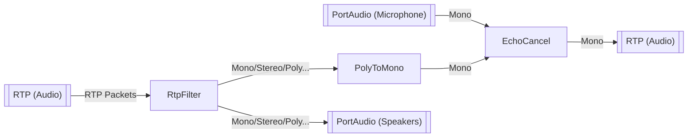
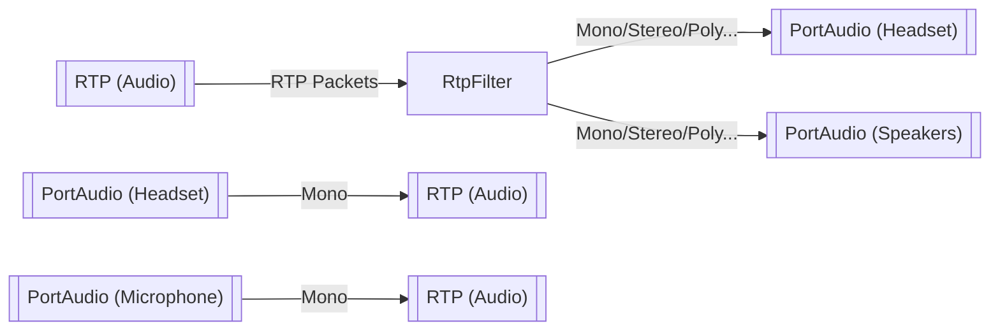

# Audio Interface

## Example Echo Cancellation


## Example Multiple In/Out


## Example Configuration
```json
// using the `Echo Cancellation` example
{
  "nodes": [
    {
      "name": "Sources_PortAudio",
      "type": "Sources::PortAudio",
      "config": { /* type-specific key-value pairs here... */ }
    },
    {
      "name": "Sources_RTP",
      "type": "Sources::RTP",
      "config": { /* type-specific key-value pairs here... */ }
    },
    {
      "name": "Transforms_PolyToMono",
      "type": "Transforms::PolyToMono",
      "config": { /* type-specific key-value pairs here... */ }
    },
    {
      "name": "Transforms_RtpFilter",
      "type": "Transforms::RtpFilter",
      "config": { /* type-specific key-value pairs here... */ }
    },
    {
      "name": "Transforms_EchoCancel",
      "type": "Transforms::EchoCancel",
      "config": { /* type-specific key-value pairs here... */ }
    },
    {
      "name": "Sinks_PortAudio",
      "type": "Sinks::PortAudio",
      "config": { /* type-specific key-value pairs here... */ }
    },
    {
      "name": "Sinks_RTP",
      "type": "Sinks::RTP",
      "config": { /* type-specific key-value pairs here... */ }
    }
  ],
  "connections": [
    {
      "from": "Sources_PortAudio",
      "to": "Transforms_EchoCancel",
      "from-channel": 0 /* 0 = mono/left, 1 = stereo/right, ... */,
      "to-channel": 0 /* possibly unused for EchoCancel (always mono) */
    },
    {
      "from": "Sources_RTP",
      "to": "Transforms_RtpFilter",
      "from-channel": 0 /* possibly unused as it's RTP packets */,
      "to-channel": 0 /* possibly unused as it's RTP packets */
    },
    {
      "from": "Transforms_RtpFilter",
      "to": "Transforms_PolyToMono",
      "from-channel": 0 /* filtered SSRC of the RTP packet */,
      "to-channel": 0 /* 0 = mono/left, 1 = stereo/right, ... */
    },
    {
      "from": "Transforms_PolyToMono",
      "to": "Transforms_EchoCancel",
      "from-channel": 0 /* possibly unused for PolyToMono (always mono) */,
      "to-channel": 0 /* possibly unused for EchoCancel (always mono) */
    },
    {
      "from": "Transforms_RtpFilter",
      "to": "Sinks_PortAudio",
      "from-channel": 0 /* filtered SSRC of the RTP packet */,
      "to-channel": 0 /* 0 = mono/left, 1 = stereo/right, ... */
    },
    {
      "from": "Transforms_EchoCancel",
      "to": "Sinks_RTP",
      "from-channel": 0 /* possibly unused for EchoCancel (always mono) */,
      "to-channel": 0 /* 0 = mono/left, 1 = stereo/right, ... */
    }
  ]
}
```
